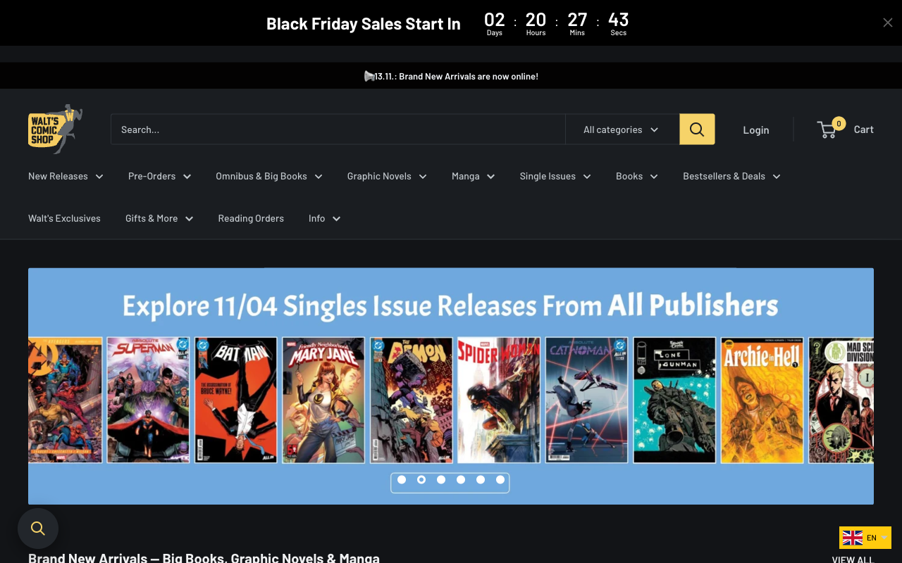

# Dark mode for Walt's Comic Shop (unofficial)

A dark theme for [waltscomicshop.com](https://waltscomicshop.com). CSS only: no scripts, no network requests, no data collected.

Not affiliated with or endorsed by Walt's Comic Shop.

## Install

- **Chrome, Edge, Brave, Vivaldi, Arc:** [Chrome Web Store](https://chromewebstore.google.com/detail/dkblkanljfclibldicedkpgneogjnfhb)
- **Firefox:** [Firefox Add-ons](https://addons.mozilla.org/firefox/addon/dark-mode-for-walts-comic-shop/)

### Userstyle managers

Install the manager, then open [walts-dark.user.css](https://raw.githubusercontent.com/jippi/dark-mode-for-walts-comics-shop/main/walts-dark.user.css) and confirm the install.

| Manager | Works in |
|---|---|
| [Stylus](https://add0n.com/stylus.html) | Chrome and friends, Firefox (desktop and Android) |
| [FireMonkey](https://addons.mozilla.org/firefox/addon/firemonkey/) | Firefox |
| [Userscripts](https://apps.apple.com/app/userscripts/id1463298887) | Safari on Mac, iPhone and iPad |
| [AdGuard](https://adguard.com) desktop app | Any browser on Windows and Mac |
| [Cascadea](https://apps.apple.com/app/cascadea/id1432182561) (paid) | Safari on Mac |

### Userscript managers

Install the manager, then open [walts-dark.user.js](https://raw.githubusercontent.com/jippi/dark-mode-for-walts-comics-shop/main/walts-dark.user.js) and confirm the install.

| Manager | Works in |
|---|---|
| [Tampermonkey](https://www.tampermonkey.net) | Chrome and friends, Firefox, Safari |
| [Violentmonkey](https://violentmonkey.github.io) | Chrome and friends, Firefox (desktop and Android) |
| [Greasemonkey](https://addons.mozilla.org/firefox/addon/greasemonkey/) | Firefox |
| [ScriptCat](https://scriptcat.org) | Chrome and friends, Firefox |
| [Userscripts](https://apps.apple.com/app/userscripts/id1463298887) | Safari on Mac, iPhone and iPad |
| [Stay](https://apps.apple.com/app/stay-for-safari/id1591620171) | Safari on Mac, iPhone and iPad |

In Chrome, userscript managers only run after you allow user scripts for them: `chrome://extensions` > the manager's "Details" > "Allow User Scripts".

Both files update themselves through the manager.

### From source

1. Download this repo (Code > Download ZIP) and unzip it.
2. Open `chrome://extensions` and turn on "Developer mode".
3. Click "Load unpacked" and pick the unzipped folder.

## Turn it off

Disable it in your manager or on your browser's extension page, then reload.

## Develop

Edit `dark.css`, then run `./build.sh` (needs `python3` and `zip`). It writes:

- `dist/chrome.zip` and `dist/firefox.zip` for the browser stores
- `walts-dark.user.css` and `walts-dark.user.js` for the managers above, both committed

Bump `version` in `manifest.json` before a release, or the managers won't see an update.

Something looks wrong on a page? Open an issue with the URL and a screenshot.
